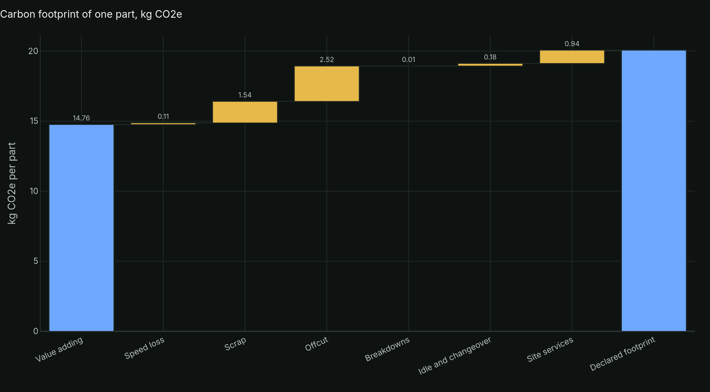
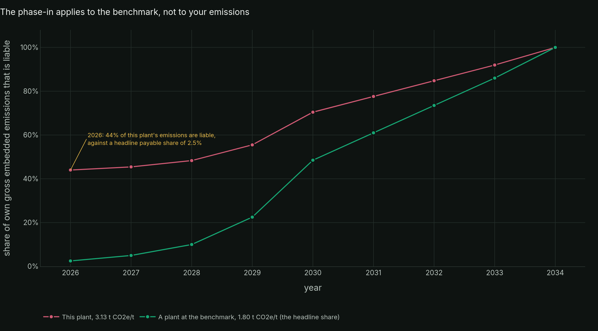
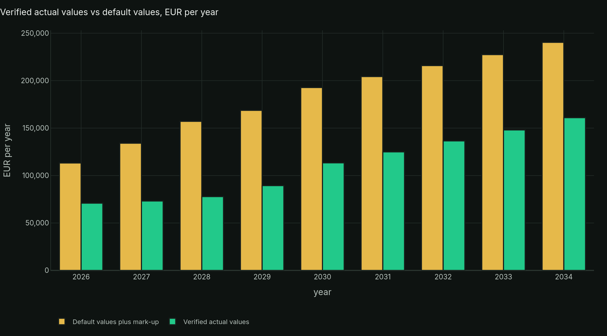
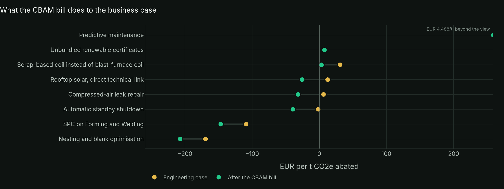
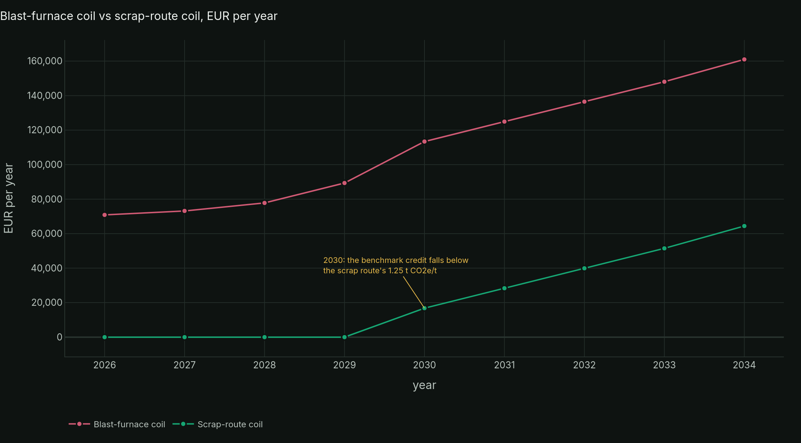

# Factory Carbon to CBAM

[](https://github.com/Muat01/factory-carbon-cbam/actions/workflows/tests.yml)
[](LICENSE)
[](https://www.python.org/)
[](https://factory-carbon-cbam.streamlit.app/)

**From cycle times to a carbon border bill: a simulated steel plant where scrap, idle time and offcut are priced at the EU border, and the improvement backlog is re-ranked once they are.**

**Try it: [factory-carbon-cbam.streamlit.app](https://factory-carbon-cbam.streamlit.app/)** — the app sleeps when idle, so the first load can take a moment to wake.



---

## The problem

The EU Carbon Border Adjustment Mechanism entered its definitive period on 1 January 2026. Exporters of steel, aluminium, cement and fertiliser to the EU now have a number attached to every tonne they ship: the emissions embedded in it, and a certificate bill that follows.

Most CBAM tools are accounting tools. They take an emissions figure as an input and produce a declaration. That leaves out the part an industrial engineer actually controls: **where the embedded emissions come from on the shop floor, and which improvements move them.**

This project joins the two halves. A production line model turns cycle times, breakdowns and scrap into energy and material; that becomes a product carbon footprint in the units CBAM uses; that becomes a certificate bill; and the bill re-prices the plant's own improvement backlog. The plant is simulated. The regulatory mechanics are modelled from the published rules.

## What it does

**Layer 1, the shop floor.** Four stations, each with an ideal cycle time, a performance factor, an availability from MTBF and MTTR, and a scrap rate. A yield cascade turns required good parts into the parts every upstream station must process; the station whose capacity yields the fewest good parts sets the line rate. Running hours split exactly into value-adding time, speed loss and scrap rework, and the remaining planned time splits into breakdown, idle and changeover. Each bucket carries its own power draw, so the energy and carbon attribution sums to the total with no residual.

**Layer 2, the footprint and the bill.** Direct fuel, indirect electricity and precursor steel, divided by tonnes of good product. Verified actual values or published default values with their regulatory mark-up. The benchmark-based free allocation adjustment, the certificate count, the carbon price already paid at origin, and the 50-tonne de minimis threshold.

**Layer 3, abatement.** Eight levers, each evaluated at the baseline order book, each priced twice: as an engineering investment, and again after the CBAM bill it avoids.

| Page | What it answers |
|---|---|
| Overview | Where the kilograms in one part come from, and what the year's bill is |
| Shop floor | Which losses carry the carbon, station by station |
| Product footprint | The declared number, how stable it is, and what verifying it is worth |
| CBAM bill | The declaration line by line, the phase-in, the price paths, the de minimis step |
| Abatement | The marginal abatement cost curve, before and after the carbon price |
| Method and sources | Formulas, assumptions, limitations, and where each rule comes from |

## Results

All figures below are from `results/*.csv`, regenerated by `python experiments.py`. **The plant is simulated.** Parameters are illustrative.

### The plant

| Metric | Value |
|---|---|
| Output | 1,359 t a year, 212,296 parts |
| Bottleneck | Welding, OEE 76.7% (A 91.0% / P 88.0% / Q 95.7%) |
| Energy | 532 MWh electricity, 527 MWh thermal |
| Material | 1,762 t steel in, 77.1% yield |
| Footprint | **3.135 t CO2e per tonne**, 20.06 kg per part |
| Across 20 replications | 3.138 ± 0.016 t CO2e/t (95% CI, 25% variation on MTBF, MTTR and scrap) |

### A quarter of the footprint is not value adding

| Loss | kg CO2e per part | Share |
|---|---|---|
| Value adding | 14.76 | 73.6% |
| Offcut that nesting never puts into a part | 2.52 | 12.6% |
| Scrapped parts | 1.54 | 7.7% |
| Site services | 0.94 | 4.7% |
| Idle and changeover | 0.18 | 0.9% |
| Running below nameplate speed | 0.11 | 0.6% |
| Breakdowns | 0.01 | 0.0% |

A rejected part wastes the steel in it and the energy already spent on it, and then raises the carbon intensity of every part that does ship. Breakdowns barely register here because the machines draw almost nothing while stopped — which is itself worth knowing, because it means reliability work has to be justified on capacity, not on carbon.

### The headline phase-in is not what a high-carbon exporter pays



The free allocation adjustment is **benchmark-based, not emissions-based**: the credit is `CBAM factor x CSCF x benchmark`, so an installation emitting more than the benchmark is liable for the excess from the first year.

| Year | Headline payable share | This plant's own liable share | Bill at a flat ETS price |
|---|---|---|---|
| 2026 | 2.5% | **44.0%** | EUR 70,858 |
| 2030 | 48.5% | 70.4% | EUR 113,383 |
| 2034 | 100% | 100% | EUR 160,992 |

A plant sitting exactly on the benchmark really does start at 2.5%. This one declares 3.135 t CO2e/t against a 1.80 t/t benchmark, so 44% of its embedded emissions are payable in year one. On an ETS price rising 6% a year the 2034 bill is EUR 256,597.

### Verified data is worth more than the measuring costs



Published default values are built by taking the highest available value across origins and are then marked up 10% in 2026, 20% in 2027 and 30% from 2028. Declaring 3.13 t CO2e/t with verified data instead of 3.96 t CO2e/t from the default route saves **EUR 42,388 in 2026, or 37% of the bill**.

### The carbon price flips two levers from cost to investment



| Lever | Abatement | EUR/t CO2e, engineering | EUR/t CO2e, after CBAM | CBAM saved | Payback |
|---|---|---|---|---|---|
| Nesting and blank optimisation | 219 t | −169 | −207 | EUR 8,282 | 0.2 yr |
| SPC on Forming and Welding | 122 t | −109 | −147 | EUR 4,628 | 0.6 yr |
| Automatic standby shutdown | 18 t | −2 | −39 | EUR 696 | 2.8 yr |
| **Compressed-air leak repair** | 30 t | **+6** | **−32** | EUR 1,131 | 2.1 yr |
| **Rooftop solar, direct technical link** | 136 t | **+12** | **−25** | EUR 5,128 | 6.3 yr |
| Scrap-based coil instead of blast-furnace coil | 2,555 t | +31 | +3 | EUR 70,858 | — |
| Unbundled renewable certificates | 136 t claimed | +8 | +8 | EUR 0 | — |
| Predictive maintenance | 3.7 t | +4,488 | +4,450 | EUR 138 | — |

Three findings worth more than the table:

1. **The paper claim and the physical array abate the same 136 t on paper, and only one of them moves the bill.** CBAM accepts an electricity factor below the country default only where a direct technical link or a qualifying power purchase agreement can be proven. Without the carbon price the certificate looks like the cheaper option; with it, the array wins.
2. **Predictive maintenance is a capacity lever here, not a carbon lever.** It frees 16 t of spare capacity but abates almost nothing, because the stations draw little power while down. In the discrete-event companion project the same lever was the throughput winner. Both are true; they are answering different questions.
3. **Switching to scrap-route coil takes the plant below the benchmark**, which zeroes the bill entirely through 2029. In 2030 the benchmark credit falls under the scrap route's 1.254 t CO2e/t and a bill restarts at EUR 16,801.



Installing the five shop-floor levers together abates 385 t, not the 394 t the individual figures add up to: a **2.1% overlap**, because cutting scrap and cutting idle draw chase some of the same kilowatt-hours.

### Two smaller results

**The de minimis threshold is a step, and it belongs to the importer.** At 40.8 t a year shipped there is no authorisation, no declaration and no certificate; at 54.3 t the full obligation applies to everything imported, not just the excess, and the bill is EUR 6,748.

**A carbon price at home is deducted from the bill abroad.** At the current Indonesian level of about EUR 4/t, full coverage would cut the 2030 bill by 6%. At the Energy Ministry's stated USD 40 target it would cut it by 63%. The money is collected either in Jakarta or in Brussels.

## Honest limitations

- **Everything is simulated.** The plant does not exist and no company data was used.
- **The CBAM benchmarks and default values in `data/parameters.json` are illustrative placeholders**, not official figures. They were not tuned to produce a particular answer — each is derived from a stated construction rule documented in the file, so a reader can check the logic and substitute the real values from Commission Implementing Regulation (EU) 2025/2621. Results will move when they do.
- **The carbon-price-paid deduction is a simplification**, modelled as a monetary credit capped at the gross cost rather than through the full implementing-act procedure.
- **The line model is analytic.** It has no buffers, no blocking and no queueing dynamics, so it will not reproduce a discrete-event simulation exactly. That was a deliberate trade for an exact energy decomposition; [production-line-simulation-simpy](https://github.com/Muat01/production-line-simulation-simpy) covers the dynamics.
- **Lever effect sizes and capital costs are plausible engineering estimates**, not quotations. The solar array is at least sized from the model's own consumption rather than guessed: 30% of 532 MWh is about 160 MWh a year, which needs roughly 110 kWp at a tropical yield near 1,450 kWh/kWp.
- **Not legal or compliance advice.** Do not file anything based on this.

## Getting started

The app runs live at **[factory-carbon-cbam.streamlit.app](https://factory-carbon-cbam.streamlit.app/)**. To run it yourself:

```bash
git clone https://github.com/Muat01/factory-carbon-cbam.git
cd factory-carbon-cbam
python -m venv .venv && . .venv/bin/activate      # Windows: .venv\Scripts\activate
pip install -r requirements.txt

streamlit run app.py        # the interactive app
python experiments.py       # regenerate every CSV in results/
python make_docs.py         # regenerate every PNG in docs/
pytest                      # 123 tests
```

## Tests

123 tests, all green in CI on every push.

| Suite | Tests | What it guards |
|---|---|---|
| `test_plant.py` | 33 | Energy, fuel, material and carbon attributions each sum exactly to their total; the OEE identity reproduces output to 1e-9; output is linear in operating days, which is what the constant-order-book comparison rests on; the gamma sampler survives a zero coefficient of variation |
| `test_cbam.py` | 28 | The published phase-out schedule year by year; the SEFA formula; liability floored at zero; the de minimis step applying to everything rather than the excess; the country grid factor applying without a PPA; a plant at the benchmark paying exactly the headline share |
| `test_levers.py` | 21 | The annuity formula; every lever judged at the same output; a higher carbon price never making a lever look worse; the curve sorted and free of paper instruments |
| `test_experiments.py` | 12 | Every CSV written, loss shares summing to one, the shipped results matching a fresh run |
| `test_charts.py` | 15 | Every figure building from the shipped CSVs, the layout helper merging rather than duplicating keys, the capped views labelling what they left out |
| `test_app.py` | 14 | All six pages rendering headlessly through `streamlit.testing.v1.AppTest`, each sidebar control present, and the on-screen numbers responding to the controls |

The five-hue categorical palette passes the lightness-band, chroma-floor, colour-vision-separation and contrast checks on both the dark and the light surface.

## Data availability

There is no private data in this repository and none is needed. Everything is generated from `data/parameters.json`, which carries a source note on every factor. The plant is invented. The regulatory parameters are modelled from public rules, with the benchmarks and default values as clearly flagged placeholders.

## Project structure

```
factory-carbon-cbam/
  app.py              Streamlit app, six pages
  config.py           typed scenario objects and the JSON loader
  plant.py            layer 1: production, energy, material, loss attribution
  cbam.py             layer 2: embedded emissions and the certificate bill
  levers.py           layer 3: abatement levers, economics, MACC
  experiments.py      writes every CSV in results/
  charts.py           Plotly figure builders, shared by the app and the docs
  make_docs.py        writes every PNG in docs/
  ui.py               HTML components for the app
  theme.py            MH Emerald & Gold design tokens
  data/               parameters.json, every number with a source note
  results/            generated CSVs
  docs/               generated figures
  tests/              123 tests
  carousel/           make_carousel.py builds the 1080x1350 LinkedIn carousel
```

## Possible extensions

- Feed the health index from [asset-health-digital-twin](https://github.com/Muat01/asset-health-digital-twin) into the reliability parameters, so maintenance policy drives the carbon number directly.
- Replace the analytic line with the discrete-event model so buffers and blocking affect idle energy.
- Add aluminium and cement routes, which have very different direct-to-indirect splits.
- Generate a CBAM-shaped declaration export once the official benchmark and default value tables are loaded.
- Fit the precursor factor to supplier-specific declarations instead of a single route average.

## Sources

- Regulation (EU) 2023/956 establishing the Carbon Border Adjustment Mechanism, and the Omnibus I amendment introducing the 50 t mass threshold and lowering the quarterly certificate holding requirement from 80% to 50%.
- Article 10a(1a) of Directive 2003/87/EC for the free allocation phase-out: 2.5% in 2026, 5% in 2027, 10% in 2028, 22.5% in 2029, 48.5% in 2030, 61% in 2031, 73.5% in 2032, 86% in 2033, 100% in 2034.
- Commission Implementing Regulation (EU) 2025/2621 for default values and country grid factors; the free allocation adjustment rules for SEFA and the FAA.
- Annex IV of the CBAM Regulation for when actual indirect emissions may be claimed: a direct technical link or a qualifying power purchase agreement.
- EUA December-2026 futures traded around EUR 90/t in November 2026; a Reuters analyst poll put the 2026 average at EUR 92.65/t and 2027 at EUR 107.29/t.
- IDXCarbon traded around IDR 67,000/t, roughly USD 4/t; Indonesia's carbon tax under Law 7/2021 is legislated but not yet enforced.
- IPCC 2006 default emission factor for natural gas, 56.1 t CO2/TJ.

## Author

**Muatasem Hadi** — MEng Industrial Engineering, Telkom University, Bandung.
[GitHub](https://github.com/Muat01) · [LinkedIn](https://www.linkedin.com/in/muatasem-hadi)

Part of a portfolio on using data, simulation and software to improve manufacturing: [predictive maintenance](https://github.com/Muat01/sutm-predictive-maintenance-dashboard) · [line simulation](https://github.com/Muat01/production-line-simulation-simpy) · [SPC and OEE](https://github.com/Muat01/spc-oee-quality-dashboard) · [asset health digital twin](https://github.com/Muat01/asset-health-digital-twin) · [scheduling copilot](https://github.com/Muat01/production-scheduling-copilot)

MIT licensed.
